<div align="center">

# BuildFlow ERP

**Gestão completa para lojas de materiais de construção: PDV, estoque, financeiro e um assistente de IA, em uma interface moderna.**

[](https://nextjs.org/)
[](https://react.dev/)
[](https://www.typescriptlang.org/)
[](https://tailwindcss.com/)
[](https://ui.shadcn.com/)
[](#-assistente-de-ia)
[](https://cerulean-kashata-afef36.netlify.app)
[](LICENSE)

[**Ver demonstração**](https://cerulean-kashata-afef36.netlify.app) · [Funcionalidades](#-funcionalidades) · [Assistente de IA](#-assistente-de-ia) · [Como rodar](#-como-rodar)

<br/>

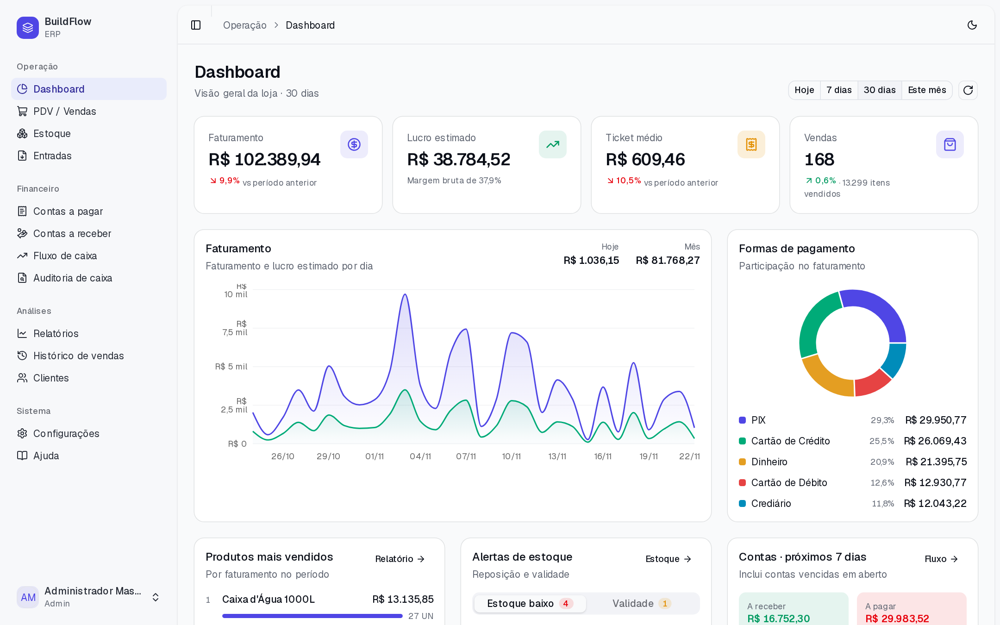

</div>

> **Demonstração:** entre com `admin@buildflow.com.br` / `admin123`. Os dados de demonstração ficam salvos só no seu navegador. Para voltar ao estado inicial, use Configurações → Dados → **Restaurar dados de demonstração**.

---

## ✨ Funcionalidades

### 🛒 PDV — frente de caixa em tela cheia

Pensado para o balcão: leitura de código de barras, atalhos de teclado para tudo e fechamento de caixa conferido por forma de pagamento.

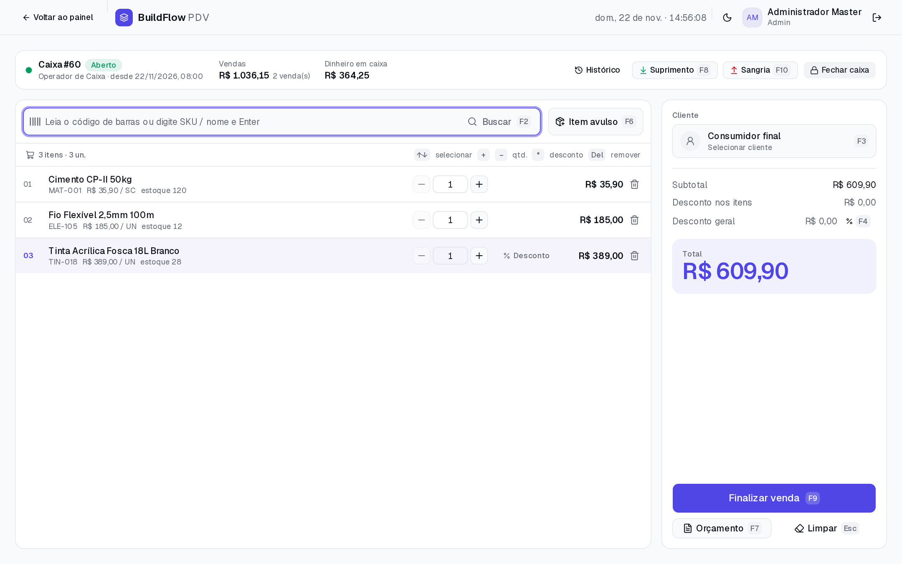

- **Atalhos:** F2 buscar, F3 cliente, F4 desconto, F6 item avulso, F7 orçamento, F8 suprimento, F9 finalizar, F10 sangria e Esc limpar
- **Descontos:** por item ou na venda, em % ou R$
- **Pagamento:** dinheiro com troco, PIX, cartões, boleto, crediário (gera a conta a receber) e pagamento dividido
- **Caixa:** abertura, sangria, suprimento e fechamento com esperado × contado
- **Comprovante:** cupom não fiscal de 80 mm pronto para imprimir

### 📦 Estoque e entradas

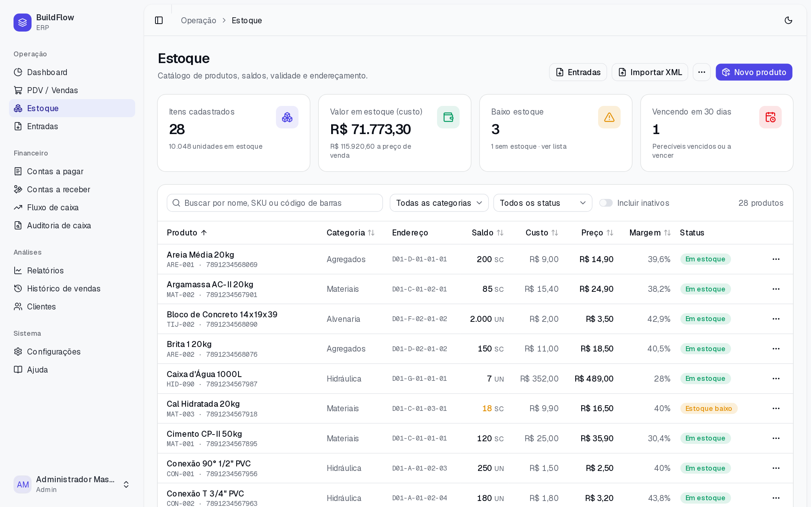

| | |
|:--|:--|
| 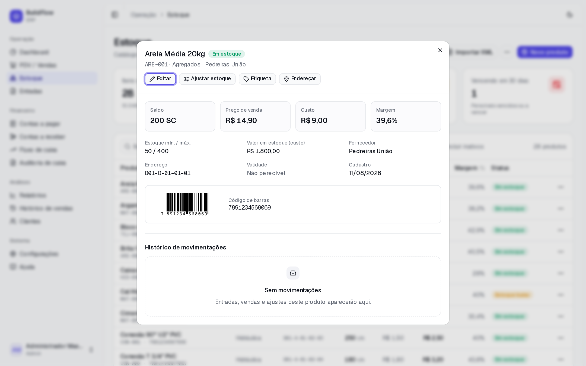 | 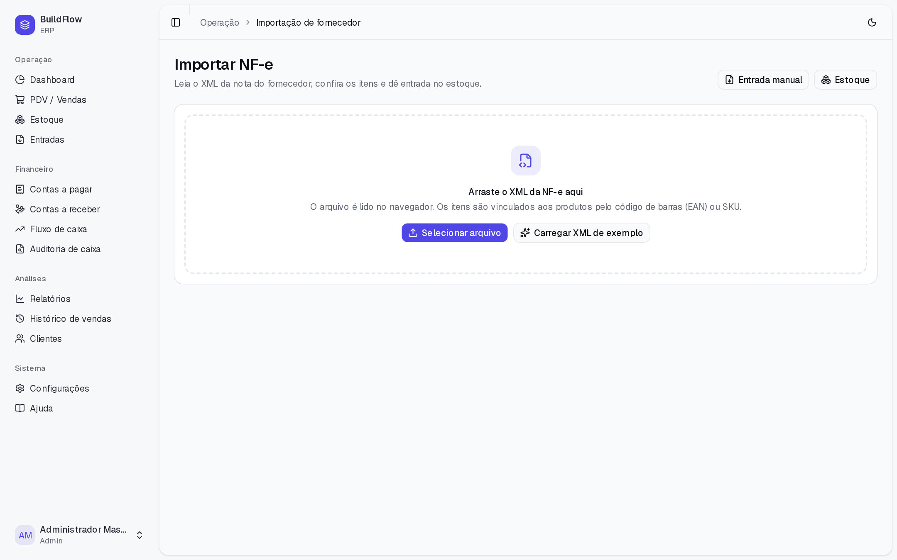 |
| **Produto:** saldo, margem, endereço, código de barras e histórico de movimentações | **Importação de NF-e:** lê o XML, casa os itens com o cadastro e cria os produtos novos |

- **Cadastro:** produtos com SKU, EAN, validade, estoque mínimo e máximo e alertas de reposição
- **Ajustes:** entrada, saída ou contagem de inventário, sempre com motivo e histórico
- **Entrada de mercadorias:** por nota, com atualização do preço de custo
- **Endereçamento:** depósito, corredor, prateleira, nível e posição, com mapa visual do armazém
- **Etiquetas:** de preço e de prateleira, com código de barras EAN-13 / Code 128 gerado no navegador

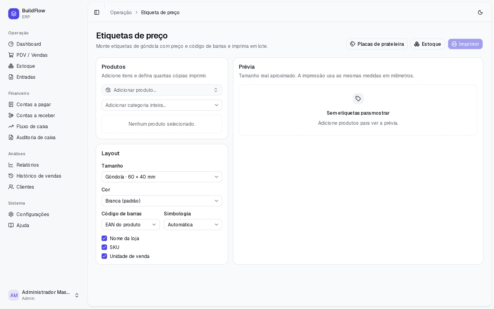

### 💰 Financeiro

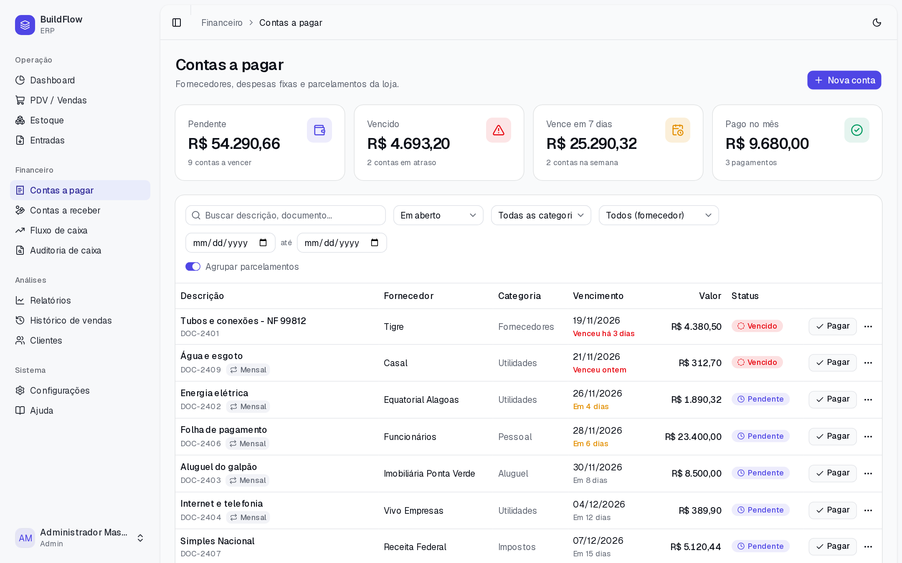

- **Contas a pagar e a receber:** parcelamento, contas recorrentes, baixa com data e forma de pagamento, alertas de vencimento
- **Fluxo de caixa:** realizado + projeção de 30 dias, com saldo acumulado e detalhe de cada dia
- **Auditoria de caixa:** cada sessão com vendas por forma de pagamento, sangrias, suprimentos e diferenças
- **Clientes:** validação de CPF/CNPJ, histórico de compras e contas em aberto

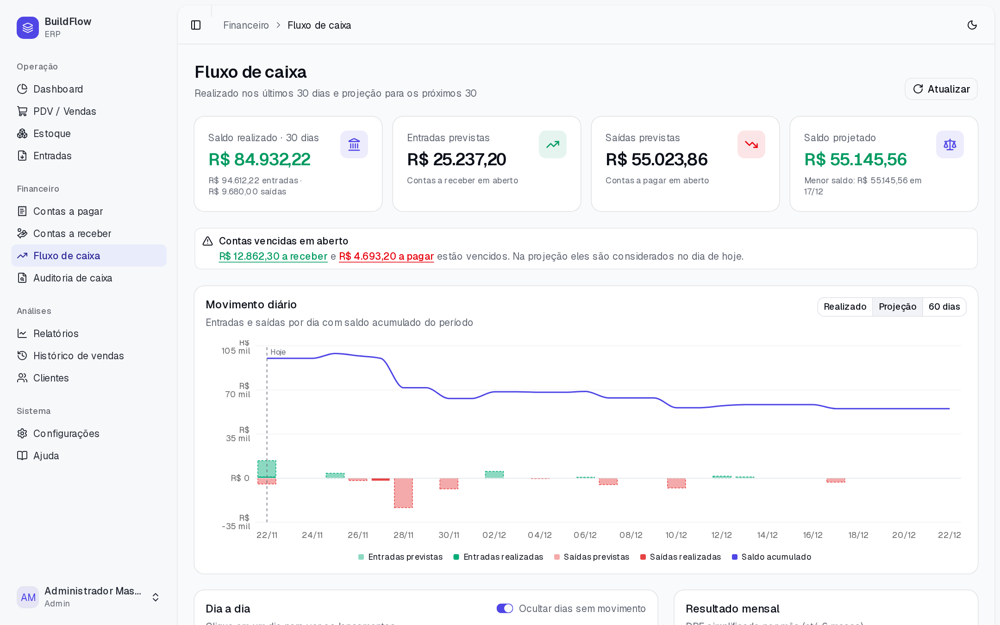

### 📊 Relatórios

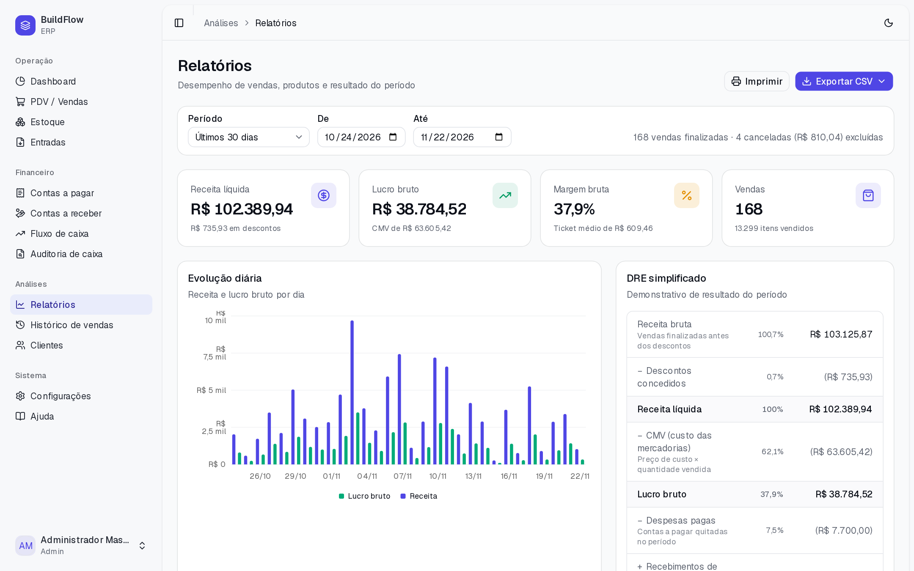

- **Indicadores:** faturamento, lucro estimado, ticket médio e comparação com o período anterior
- **Análises:** vendas por produto (com curva ABC), por categoria e por forma de pagamento
- **DRE simplificado:** receita, descontos, CMV, lucro bruto, despesas e resultado
- **Exportação:** CSV pronto para o Excel e versão para impressão

---

## 🤖 Assistente de IA

Na página **Ajuda**, o **Assistente BuildFlow** tira dúvidas sobre o sistema e executa tarefas da loja em linguagem natural.

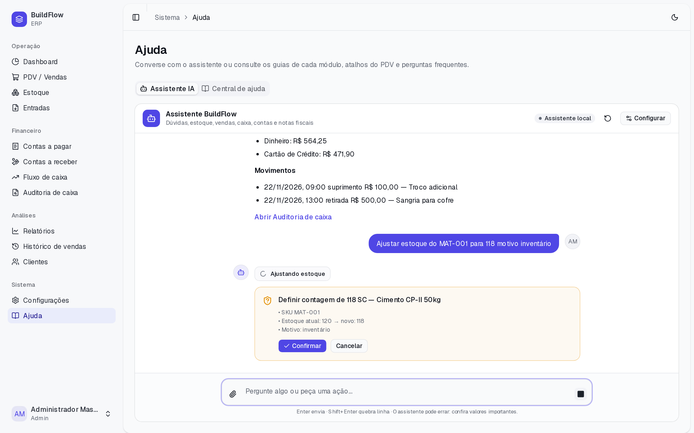

**O que ele faz:**
- **Consultas:** "o que está com estoque baixo?", "quanto tem de cimento?"
- **Resumos:** caixa, vendas do dia ou do mês, DRE, contas a pagar e a receber
- **Correção de estoque:** "ajustar estoque do MAT-001 para 118 motivo inventário"
- **Notas fiscais:** anexe o XML da NF-e e peça "importar nota"
- **Dúvidas de uso:** "como faço uma sangria?", "como parcelar uma conta?"

**Escolha o "cérebro" em Configurar:**

| Provedor | Como funciona | Chave de API |
|:--|:--|:--|
| **Assistente local** (padrão) | Reconhece pedidos diretos, sem IA externa e sem custo | Não precisa |
| **Claude (Anthropic)** | Conversa livre com `claude-opus-5-5`, streaming e raciocínio adaptativo | A do próprio usuário |
| **OpenAI** | Conversa livre via function calling | A do próprio usuário |

Os três usam **as mesmas ferramentas**, que chamam as mesmas funções das telas. Toda ação que altera dados mostra um cartão de **confirmação**: nada muda sem o seu clique. A chave de API fica só no navegador e vai direto para o provedor.

---

## 🌗 Tema claro e escuro · responsivo

| | |
|:--|:--|
| 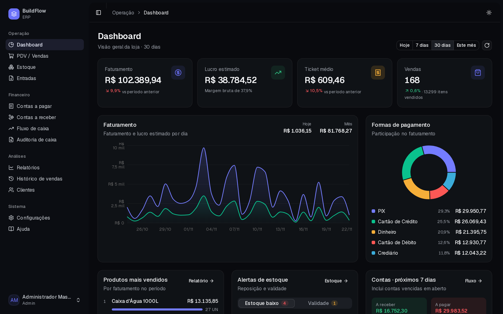 | 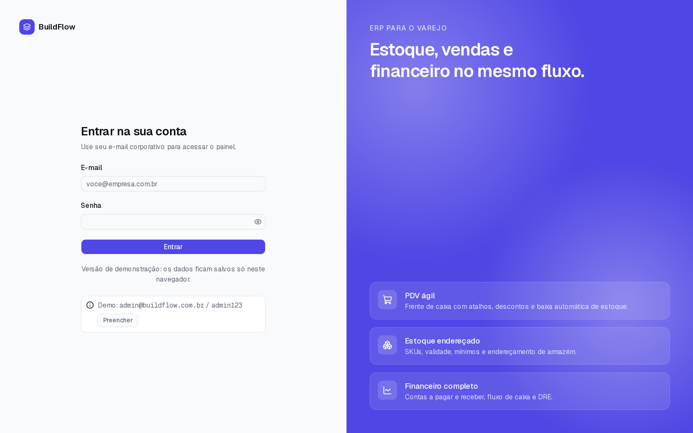 |

<p align="center">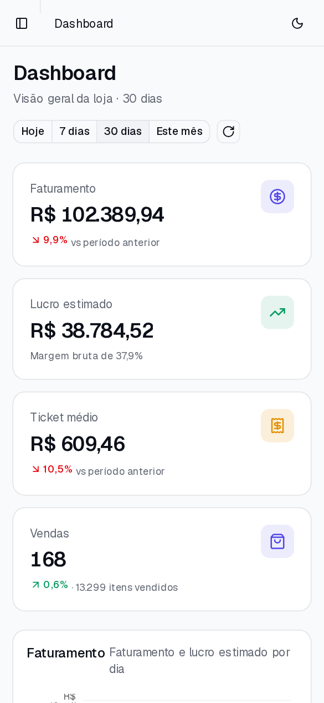</p>

---

## 🧱 Arquitetura

```text
buildflow-erp/
├── web/                  # Front-end (Next.js 16 + shadcn/ui), exportado como site estático
│   └── src/
│       ├── app/(app)/    # Telas com menu lateral
│       ├── app/(pos)/    # PDV em tela cheia
│       ├── components/   # shadcn/ui + componentes por domínio (pos, inventory, finance, analytics, assistant)
│       └── lib/
│           ├── services/   # Funções de dados usadas pelas telas (via React Query)
│           ├── assistant/  # Agente de IA: ferramentas + provedores Claude, OpenAI e local
│           ├── domain/     # Tipos e regras de negócio (totais, estoque, status de contas)
│           └── mock/       # Dados de demonstração (memória + localStorage)
├── netlify/functions/    # API serverless (Node.js + MongoDB Atlas)
├── src/                  # Utilitários do back-end, seed e migrações
└── tests/                # Testes unitários e de integração da API
```

| Camada | Tecnologias |
|:--|:--|
| **Front-end** | Next.js 16 (App Router, export estático), React 19, TypeScript, Tailwind CSS 4, shadcn/ui, TanStack Query, Recharts |
| **IA** | Anthropic SDK (Claude), OpenAI SDK, Zod para validar as entradas das ferramentas |
| **Back-end** | Netlify Functions (Node.js), MongoDB Atlas, JWT em cookie HttpOnly, bcrypt, rate limiting |
| **Qualidade** | ESLint, testes com `node --test`, baseline de 19 endpoints da API, GitHub Actions |
| **Deploy** | Netlify: site estático em `web/out` + functions em `/api/*` |

> **Status:** o front-end novo roda com dados de demonstração. As telas só falam com `web/src/lib/services`, então ligar à API real significa reescrever essas funções para chamar `/api/*`, sem mudar as telas.

---

## 🚀 Como rodar

**Pré-requisito:** Node.js 22+

### Front-end

```bash
git clone https://github.com/RobertoBarbosa-AurTTY/ERP_BuildFlow_Demo.git buildflow-erp
cd buildflow-erp/web
npm install
npm run dev          # http://localhost:3000
```

```bash
npm run build        # gera o site estático em web/out
npm run lint
```

### API (Netlify Functions)

```bash
cd buildflow-erp
npm install
printf "MONGODB_URI=sua_uri_do_atlas\nJWT_SECRET=troque_esta_chave\n" > .env
npm run seed           # usuário admin e dados de exemplo
npx netlify dev        # functions em http://localhost:8888/api/*
```

| Script | O que faz |
|:--|:--|
| `npm test` | Testes unitários |
| `npm run test:integration` | Testes de integração (requer `MONGODB_URI`) |
| `npm run capture-baseline` / `compare-baseline` | Confere as respostas da API contra a baseline |
| `npm run ensure-indexes` | Cria os índices do MongoDB |

---

## ☁️ Deploy

O `netlify.toml` já está configurado: roda `npm run build --prefix web`, publica `web/out` e mantém as functions em `/api/*`.

- **Pull requests** ganham um **Deploy Preview** com link próprio
- **Merge na `main`** publica em produção

---

## 👤 Autor

Feito por **[Roberto Carlos](https://github.com/RobertoBarbosa-AurTTY)**: desenvolvedor full-stack com foco em backend TypeScript e engenharia assistida por IA.

[](https://linkedin.com/in/robertobarbosa-rc)
[](https://robertobarbosa-rc.netlify.app/)

## 📄 Licença

Distribuído sob a licença MIT. Veja [LICENSE](LICENSE).
